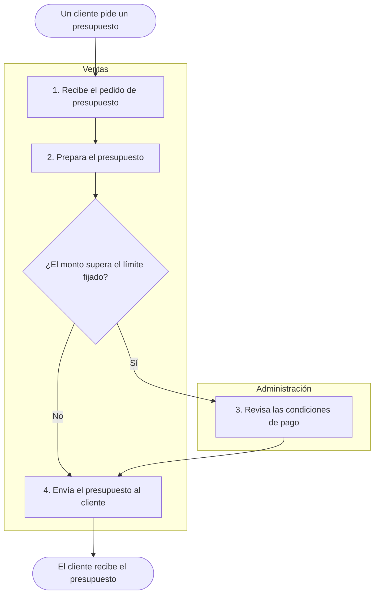

# Control documental

Este archivo indica cómo se identifica, se versiona, se aprueba y se revisa cada archivo de `empresa/`. Leerlo completo antes de crear un documento, de asignar un código o de cambiar un estado.

Este vocabulario es para el agente. En la conversación se usan las palabras simples de la regla 8 de `metodo/reglas.md`.

## En una mirada

| Tema | Regla |
|---|---|
| Tipos de archivo | Documento controlado, documento de trabajo o registro. Cada tipo se cuida distinto. |
| Código | `TIPO-ÁREA-NNN`. Se asigna solo desde `empresa/lista-maestra.md`. |
| Bloque de control | Dos tablas al principio de cada documento controlado. Es la fuente de verdad. |
| Estados | `pendiente`, `en curso`, `borrador`, `validado`, `vigente` y `obsoleto`. |
| Versión | `0` hasta la primera aprobación. Cada aprobación suma 1. |
| Aprobar | Cuatro cosas juntas o ninguna: versión, historial, próxima revisión y lista maestra. |
| Documento vigente | Su contenido aprobado no se reescribe. Los cambios se anotan como propuestos hasta que se aprueban. Las secciones de trabajo se ponen al día sin aprobación. |
| Revisión periódica | Fecha de aprobación más el período definido en el arranque. |
| Ramas | Las sesiones escriben en `borradores`. `main` tiene solo lo revisado. |
| Archivos recibidos | Se revisan, se guardan con la fecha en el nombre y se catalogan. El original no se toca. |
| Diagramas | Salen de la tabla de pasos y se vuelven a generar cuando la tabla cambia. |

## Los tres tipos de archivo

| Tipo | Cuáles son | Cómo se cuida |
|---|---|---|
| Documento controlado | Contexto, mapa de procesos, fichas de proceso, instructivos y glosario. Los formularios, cuando tengan molde | Lleva código, versión, estado, aprobación y revisión periódica. |
| Documento de trabajo | Hojas de personas, fichas de cambio, lista maestra y notas para el método | Se identifica por su ruta. Se actualiza libremente. No se aprueba. |
| Registro | Sesiones, insumos y adjuntos | Se cierra una vez escrito. Después no se edita. La única excepción es la línea de subida de un registro de sesión, que cambia si la subida falla. |

El tipo de cada archivo sale de su lugar en `empresa/`:

| Lugar en `empresa/` | Tipo | Código |
|---|---|---|
| `contexto.md` | Documento controlado | `CT-GEN-001` |
| `mapa-de-procesos.md` | Documento controlado | `MP-GEN-001` |
| `glosario.md` | Documento controlado | `GL-GEN-001` |
| `procesos/<area>/<codigo>-<slug>.md` | Documento controlado | `PR-ÁREA-NNN` |
| `instructivos/<area>/<codigo>-<slug>.md` | Documento controlado | `IN-ÁREA-NNN` |
| `personas/<nombre>.md` | Documento de trabajo | No lleva |
| `cambios/<slug>/ficha-del-cambio.md` | Documento de trabajo | No lleva |
| `lista-maestra.md` | Documento de trabajo | No lleva |
| `notas-para-el-metodo.md` | Documento de trabajo | No lleva |
| `sesiones/`, `insumos/` y `adjuntos/` | Registro | No lleva |

- Todo documento nuevo se crea copiando su molde de `plantillas/`. La nota inicial de cada molde dice a qué lugar de `empresa/` va la copia. La única excepción es `empresa/notas-para-el-metodo.md`, que no tiene molde: su forma está en la regla 10 de `metodo/reglas.md`.
- Un documento creado con una versión anterior de su molde no se rehace. La próxima vez que se toca, se completa solo su estructura: las secciones y las columnas que le faltan. Lo que ya estaba escrito no se mueve ni se pasa a la forma nueva.
- Una parte nueva queda con su ayuda hasta que alguien cuente ese dato. Si ya ninguna etapa lo va a preguntar, se suma como pregunta a la hoja del responsable del programa.
- El `catalogo.md` de `insumos/` y el de cada carpeta de `adjuntos/` son documentos de trabajo: se actualizan cada vez que llega un archivo.
- Los formularios todavía no tienen lugar propio ni molde, y por eso todavía no son documentos controlados. Hasta que se definan, no se asignan códigos `FO`. Un formulario que aporta una persona se guarda como cualquier otro archivo aportado, en `empresa/adjuntos/`. Lo mismo vale para los documentos de afuera que la empresa usa, como una norma o un manual de un proveedor: se catalogan, pero no se controla qué versión está en uso.

## Códigos

El código tiene la forma `TIPO-ÁREA-NNN`. Por ejemplo, `PR-VEN-001` es la primera ficha de proceso de un área cuyas letras son `VEN`.

| Parte | Qué es | Valores |
|---|---|---|
| `TIPO` | Dos letras según el tipo de documento | `CT` contexto, `MP` mapa de procesos, `GL` glosario, `PR` ficha de proceso, `IN` instructivo, `FO` formulario |
| `ÁREA` | Tres letras mayúsculas | Las que se definieron en el arranque y figuran en `empresa/contexto.md`. `GEN` para lo que es de toda la empresa |
| `NNN` | Tres cifras | Correlativo dentro de cada tipo y área. Empieza en `001` |

- En las rutas, la carpeta del área lleva el nombre del área (`<area>`). El código lleva sus tres letras. La correspondencia entre nombre y letras está en `empresa/contexto.md`.
- Lo que es de toda la empresa usa el área "General", la carpeta `general` y las letras `GEN`.
- Un proceso también puede ser de toda la empresa, como decidir hacia dónde va. Su código es `PR-GEN-NNN` y su ficha va en `empresa/procesos/general/`.
- El código de un documento no cambia cuando cambian su nombre, su estado o su versión. Cambia solo en los dos casos de "Cambiar un código".
- Un número nunca se reutiliza, aunque el documento quede `obsoleto` o se haya creado por error.

### Cómo se asigna un código

1. Abrir `empresa/lista-maestra.md`. Si no existe, crearla copiando `plantillas/lista-maestra.md`.
2. Comprobar que el documento no tiene ya un código: buscar su título y su ubicación en la lista.
3. Definir el tipo y el área. Si no se sabe de qué área es, o si el área no tiene letras en `empresa/contexto.md`, el código no se asigna y no se inventa nada. Un proceso en esa situación figura igual en el mapa, sin código, como indica "Mapa de procesos". Recibe su código cuando se sabe su área. La única excepción es la entrevista sobre ese proceso, que no se posterga: ahí toma un área provisoria, como indica "Un proceso sin código" en `metodo/entrevista.md`.
4. Buscar en la lista todas las filas de ese tipo y esa área, también las que están `obsoleto`. Contar también los códigos anteriores anotados en "Observaciones". Tomar el número más alto y sumar 1. Si no hay ninguno, el número es `001`.
5. Agregar la fila a la lista, con estado `pendiente` y versión `0`. En "Elaboró" va `—` mientras el documento no tiene archivo. La fila se escribe antes que cualquier otra cosa.
6. Escribir el código donde corresponde: en la fila del mapa de procesos, si es un proceso; en el nombre del archivo y en el bloque de control, cuando el archivo se crea. Si el proceso ya figuraba en el mapa sin código, cambiar también el `—` por el código en las hojas de las personas que lo tienen anotado.
7. El código queda guardado con el guardado del tema o de la etapa en curso. No lleva un guardado propio.

El número se elige mirando la lista maestra. Nunca se eligen números contando los archivos de una carpeta. Las filas de la lista no se borran.

### Dos documentos con el mismo código

Puede pasar cuando dos computadoras asignan un código antes de ponerse al día. Al encontrarlo:

1. No borrar, no unir y no cambiar de código nada en el momento.
2. Conserva el código el documento que se guardó primero. La fecha del primer guardado de cada archivo se ve con `git log --diff-filter=A --format=%as -- <ruta>`. Si no se puede saber cuál fue primero, lo decide el responsable del programa.
3. Escribir el marcador una sola vez, en la columna "Observaciones" de la fila del documento que se guardó después: `PENDIENTE: preguntar a <responsable del programa>`, con la aclaración "código duplicado". Si no se sabe cuál fue primero, va en cualquiera de las dos filas. En "Observaciones" de la otra fila se anota, sin marcador, con qué documento se repite el código.
4. Seguir con el trabajo. El duplicado se resuelve en la etapa de conciliación de `metodo/revision-y-aprobacion.md`.

Para resolverlo, seguir "Cambiar un código" con el documento que se guardó después.

### Cambiar un código

Un código cambia solo en dos casos:

| Caso | Cuándo se hace |
|---|---|
| Dos documentos quedaron con el mismo código | En la etapa de conciliación de `metodo/revision-y-aprobacion.md`. |
| Quien tenía que confirmar el área provisoria de un proceso la corrige | Cuando lo dice, y solo si la ficha no está `vigente`. |

1. Asignar el código nuevo con los pasos de "Cómo se asigna un código".
2. Cambiar el código en el bloque de control, en el nombre del archivo, en la fila de la lista maestra, en el mapa de procesos y en las hojas de las personas que tienen anotado el proceso.
3. Si cambió el área, pasar el archivo a la carpeta del área nueva. Su carpeta de `empresa/adjuntos/` pasa también.
4. Anotar el código anterior en el historial del documento y en "Observaciones" de su fila de la lista maestra.
5. No corregir los registros ya cerrados que nombran el código anterior.
6. Si el documento está `vigente` y el cambio es por un código duplicado, hace falta la palabra de quien aprueba. Su versión no cambia.

El número del código anterior no se vuelve a usar.

## Bloque de control

Todo documento controlado empieza, debajo del título, con dos tablas. Son tablas a la vista, y no datos ocultos al principio del archivo, para que sigan ahí cuando el documento se imprime o se exporta.

```
| Código | Versión | Estado | Vigente desde | Próxima revisión |
|---|---|---|---|---|
| <código> | 0 | en curso | — | — |

| Elaboró | Revisó | Aprobó |
|---|---|---|
| <nombre> | — | — |
```

| Campo | Qué va | Cuándo cambia |
|---|---|---|
| Código | El código asignado en la lista maestra. | Nunca, salvo los dos casos de "Cambiar un código". |
| Versión | Un número entero. `0` hasta la primera aprobación. | Solo al aprobar. |
| Estado | Uno de los seis estados. | Como indica "Estados". |
| Vigente desde | La fecha en que se aprobó la versión actual. `—` hasta la primera aprobación. | Solo al aprobar. |
| Próxima revisión | La fecha en que toca volver a mirarlo. `—` hasta la primera aprobación. | Al aprobar y en la revisión periódica. |
| Elaboró | El nombre de pila del responsable del programa, que es quien conduce el relevamiento. | Al crear el documento. |
| Revisó | El nombre de pila del dueño del proceso que validó. `—` hasta que valide. | Al pasar a `validado`. Vuelve a `—` si el documento retrocede a `borrador`. |
| Aprobó | El nombre de pila de quien aprobó. `—` hasta la aprobación. | Solo al aprobar. |

- El agente nunca figura en el bloque.
- En "Elaboró", "Revisó" y "Aprobó" va el nombre de pila. Si dos personas de la empresa comparten el nombre, va el nombre y el área, igual que en el nombre del archivo de su hoja, como indica `empresa/README.md`.
- El contexto, el mapa de procesos y el glosario no tienen dueño de proceso. En ellos revisa el responsable del programa. Una ficha de proceso del área "General" tiene dueño, como cualquier otra.
- Si el bloque y la lista maestra no coinciden, vale el bloque. Mientras un documento no tiene archivo, vale su fila de la lista.

## Estados

Los estados avanzan en este orden: `pendiente`, `en curso`, `borrador`, `validado`, `vigente`. Aparte está `obsoleto`.

| Estado | Qué significa | Cuándo se pone |
|---|---|---|
| `pendiente` | Está identificado: figura en el mapa de procesos o en la lista maestra. Todavía no se relevó nada. Un proceso recibe su código cuando se sabe su área. El archivo puede no existir. | Al identificarlo. |
| `en curso` | El relevamiento empezó y quedan temas sin conversar. | En la sesión de relevamiento que crea el archivo. |
| `borrador` | Se conversaron todos los temas. Quedan marcadores abiertos, falta escuchar a otras personas que participan, o falta que el dueño del proceso confirme. | En la sesión de relevamiento que completa los temas. |
| `validado` | El dueño del proceso confirmó que es así, y ningún marcador abierto cambia el sentido. | Solo en `metodo/revision-y-aprobacion.md`. |
| `vigente` | Está aprobado. Es la versión oficial. | Solo en `metodo/revision-y-aprobacion.md`, con la palabra explícita de quien aprueba. |
| `obsoleto` | Fue reemplazado o dado de baja. Se conserva y no se edita más. | Solo en `metodo/revision-y-aprobacion.md`. |

- Un marcador cambia el sentido cuando afecta quién hace algo, qué se hace, en qué orden, con qué regla o con qué excepción. No lo cambia cuando falta un detalle, como una duración exacta. Ante la duda, lo cambia.
- Un documento `validado` vuelve a `borrador` si aparece un `PENDIENTE`, un `CONFLICTO` o un `A CONFIRMAR` que cambia el sentido. También si una sesión posterior le suma contenido que el dueño no leyó. Cuando retrocede, "Revisó" vuelve a `—` en el bloque y en la lista maestra.
- Una ficha en `borrador` vuelve a `en curso` si una entrevista posterior queda con temas sin cerrar.
- El glosario se crea en estado `en curso` y pasa a `borrador` al cerrar la sesión en la que se creó. Desde ahí sigue las reglas de cualquier documento, sin casos especiales: si está `validado` y se le suma un término, vuelve a `borrador`; si está `vigente`, el término nuevo va a "Cambios propuestos (sin aprobar)".
- Un documento `vigente` no retrocede. Lo que cambia se anota como indica "Cambios en un documento vigente".
- El estado se escribe en tres lugares: el bloque de control, la lista maestra y, si es una ficha, el mapa de procesos. Se cambian los tres en el mismo guardado.

## Versiones e historial

- La versión es un número entero: `0`, `1`, `2`.
- Todo documento controlado termina con la sección `## Historial`, con estas columnas: `| Versión | Fecha | Qué cambió | Quién lo contó | Quién aprobó |`.
- Los moldes traen el historial sin filas. Las filas las suma siempre el modo que está trabajando.
- Cada sesión que cambia el contenido de un documento le suma una fila al cerrarse. Va una sola fila por documento y por sesión, también en la sesión que lo crea.
- Esa fila lleva la versión que el documento tiene en ese momento, la fecha, qué se agregó y quién lo contó. En "Quién aprobó" va `—`.
- Poner al día las columnas "Estado", "Ficha", "Prioridad" y "Participantes" del mapa de procesos no cuenta como un cambio de contenido: no suma fila.
- Cada aprobación suma una fila con la versión nueva y el nombre de pila de quien aprobó.
- Validar, revisar sin cambios y dar de baja suman su propia fila en el momento, como indica `metodo/revision-y-aprobacion.md`.
- Las filas del historial no se borran ni se reescriben.

## Aprobar: cuatro cosas juntas

Antes de aprobar tienen que cumplirse las cuatro condiciones:

1. El documento está `validado`. O está `vigente` y tiene cambios propuestos que el dueño del proceso confirmó. En el contexto, el mapa de procesos y el glosario, que no tienen dueño, los confirma el responsable del programa.
2. Ningún marcador abierto cambia el sentido.
3. Quien aprueba lo dijo de forma explícita, en esta conversación y para este documento.
4. El documento tiene su fila en la lista maestra.

Al aprobar se hacen cuatro cosas juntas, en un mismo guardado:

| N.º | Qué se hace | Dónde |
|---|---|---|
| 1 | La versión suma 1. | Bloque de control |
| 2 | Se agrega una fila con la versión nueva, la fecha, qué cambió, quién lo contó y quién aprobó. | `## Historial` |
| 3 | La próxima revisión pasa a ser la fecha de aprobación más el período. | Bloque de control |
| 4 | La fila del documento queda al día. | `empresa/lista-maestra.md` |

- Junto con las cuatro se escriben "Vigente desde", "Aprobó" y el estado `vigente`. El estado se escribe al final.
- Si alguna de las cuatro no se puede hacer, el agente se niega a dejar el documento como `vigente`. Deshace lo que escribió para ese documento con `git restore -- <rutas>` y dice con palabras simples qué falta.
- Cada aprobación se guarda por separado, para poder deshacer una sin tocar las otras.

## Cambios en un documento vigente

La versión identifica el contenido aprobado. El contenido aprobado es todo el documento, salvo sus secciones de trabajo: "Problemas e ideas", "Cambios propuestos (sin aprobar)", "Historial" y las cuatro columnas del mapa que se nombran más abajo. Las secciones de trabajo se ponen al día sin aprobación y sin cambiar la versión. En una ficha de proceso, lo aprobado es "Cómo se hace hoy" y "Documentos"; "Problemas e ideas" es material de trabajo, porque no describe cómo se hace hoy.

1. No tocar lo ya escrito en el contenido aprobado.
2. Anotar el cambio en la sección `## Cambios propuestos (sin aprobar)`, que va justo antes de `## Historial`. Si el documento no tiene esa sección, agregarla ahí.
3. Usar una fila por cambio, con estas columnas: `| Fecha | Quién lo cuenta | Qué cambió | Confirmó el dueño |`. En "Qué cambió" van la parte afectada y el texto que va a quedar, tal como quedaría en el cuerpo. Así quien aprueba lee lo mismo que se va a escribir.
4. El estado sigue `vigente` y la versión no cambia.
5. Cuando el cambio se aprueba, su texto se copia tal cual al cuerpo del documento, su fila sale de la sección y se hacen las cuatro cosas de "Aprobar". Solo el diagrama se genera de nuevo, si la tabla de pasos cambió.

Cerrar un marcador que no cambia el sentido se hace en su lugar, sin cambiar la versión, con una fila en el historial. Es la única edición del contenido aprobado que no pasa por aprobación, porque por definición no cambia el sentido. Si la respuesta cambia el sentido, va a "Cambios propuestos (sin aprobar)".

Cuatro datos del mapa de procesos se actualizan sin aprobación, aunque el mapa esté `vigente`: las columnas "Estado", "Ficha", "Prioridad" y "Participantes". Las dos primeras copian datos de cada ficha. La prioridad es el orden del relevamiento y la decide el responsable del programa. "Participantes" copia lo que dicen las fichas y las hojas: dice a quién preguntar, no cómo se trabaja. "Dueño" sigue siendo contenido aprobado.

Con el mapa `vigente`, la fila de un proceso nuevo entra igual al cuerpo del mapa, con su estado, su ficha, su prioridad y sus participantes. En "Cambios propuestos (sin aprobar)" queda una fila que registra el alta. Lo que se aprueba con la versión siguiente es su nombre, su área, su tipo y su dueño.

Lo que un cambio en marcha va a modificar no se anota en la ficha del proceso mientras sea un plan. Va en la ficha del cambio, como indica `metodo/cambio-en-curso.md`.

## Datos del contexto que aparecen después del arranque

En cualquier modo puede aparecer un dato de la empresa que cambia `empresa/contexto.md`: una herramienta que no figuraba, para qué se usa, quién la usa, un lugar nuevo o algo que se decidió. Ese modo lo escribe ahí, con su fuente, en la forma que indica la regla 4 de `metodo/reglas.md`.

| Estado del contexto | Qué se hace |
|---|---|
| `en curso` o `borrador` | Escribir el dato en su parte. Si es de segunda mano, lleva `A CONFIRMAR con <quién>`. |
| `validado` | Escribirlo igual. El contexto vuelve a `borrador`. |
| `vigente` | No tocar lo escrito. Va una fila en "Cambios propuestos (sin aprobar)". |

- La sesión suma su fila al historial del contexto, como cualquier sesión que cambia un documento.
- Un área nueva es la excepción: la suma solo el responsable del programa, porque sus letras no se cambian después. Mientras tanto va como pregunta en su hoja.
- El cambio de responsable del programa o de quien aprueba es la otra excepción. Lo dice quien deja el rol o, si ya no está en la empresa, quien tiene el otro rol. Se escribe en el contexto sin esperar aprobación, aunque el contexto esté `vigente`, con una fila en el historial que diga quién lo dijo y cuándo. Las hojas de las dos personas se ponen al día en el mismo guardado.

## Revisión periódica

- La próxima revisión es la fecha de aprobación más el período definido en el arranque, que figura en `empresa/contexto.md`. Si no está definido, son 12 meses.
- La fecha cae el mismo día, tantos meses después. Si ese día no existe en el mes, cae el último día de ese mes.
- Una revisión está vencida cuando su fecha es anterior a hoy. Está por vencer cuando faltan 30 días o menos.
- Un documento con la revisión vencida sigue `vigente` hasta que la revisión decida otra cosa. El vencimiento es un aviso, no un cambio de estado.
- Además de la fecha, conviene mirar antes un documento cuando cambia una regla que sigue, o cuando un problema ya anotado en él vuelve a aparecer en otra conversación. El agente lo avisa al responsable del programa y la revisión se hace igual que la periódica. No hay otro calendario ni otro registro para esto.

Aviso: al empezar cada sesión con el responsable del programa, en cualquier modo, leer la columna "Próxima revisión" de la lista maestra y avisar qué documentos están vencidos o por vencer. Por ejemplo: "Antes de empezar: hay dos documentos que toca volver a mirar." Después, nombrar cada uno con su fecha. Si no hay ninguno, no decir nada.

Qué se hace con cada documento se decide en `metodo/revision-y-aprobacion.md`:

| Resultado | Qué pasa con el documento |
|---|---|
| Sigue igual | La versión no cambia. Se suma una fila al historial y se fija una nueva próxima revisión. |
| Cambió | El cambio se anota como propuesto y sigue el camino normal hasta su aprobación. |
| Ya no se usa | Pasa a `obsoleto`. |

## Lista maestra

- Es `empresa/lista-maestra.md` y se crea copiando `plantillas/lista-maestra.md`. Es un documento de trabajo.
- Tiene una fila por cada documento controlado, con su código, título, tipo, área, estado, versión, fechas, quién elaboró, revisó y aprobó, ubicación y observaciones.
- Tiene una tabla de registros: qué se guarda, dónde y con qué plazo mínimo de guarda. Si la empresa no fija un plazo, va "sin plazo fijo".
- La fuente de verdad es el bloque de control de cada documento. La lista se concilia contra los bloques en `metodo/revision-y-aprobacion.md`.
- Cada vez que la lista cambia, se actualiza su línea "Última actualización".

## Mapa de procesos

- Es `empresa/mapa-de-procesos.md` y se crea copiando `plantillas/mapa-de-procesos.md`. Es un documento controlado.
- Agrupa los procesos en tres tipos:

| Tipo | Qué procesos reúne |
|---|---|
| Conducción | Cómo se decide y se dirige. Aunque sea informal y decida una sola persona, lleva al menos una fila. |
| Operación | La cadena que va desde el pedido de un cliente hasta el cobro. |
| Apoyo | Lo que sostiene a la operación. |

- Sus columnas son: `| Código | Proceso | Área | Tipo | Dueño | Participantes | Estado | Prioridad | Ficha |`.
- Es la lista oficial de nombres de procesos. Todos los demás archivos nombran cada proceso exactamente como figura en el mapa.
- Para sumar un proceso, se le asigna el código, si ya se sabe su área, y se agrega su fila. Si el mapa está `vigente`, la fila entra igual al cuerpo y el alta queda registrada en "Cambios propuestos (sin aprobar)", como indica "Cambios en un documento vigente". El proceso se puede relevar mientras tanto.
- Un proceso que es de toda la empresa lleva el área "General".
- Un proceso del que todavía no se sabe el área figura en el mapa sin código: en "Código" va `—` y en "Área" va `PENDIENTE: preguntar a <quién>`. No tiene fila en la lista maestra hasta que recibe su código.
- Un proceso puede tener un área provisoria: en "Área" va el área, seguida de `A CONFIRMAR con <quién>`. Tiene código. Si esa persona corrige el área, el código cambia como indica "Cambiar un código".
- En "Participantes" van los nombres de pila de quienes intervienen además del dueño. El dueño no se repite ahí. Si no interviene nadie más, va `—`.
- Lo que hace cada persona en el proceso está en la ficha, con su marcador. Mientras el proceso no tiene ficha, está en la hoja de esa persona, y el marcador va ahí.
- Cuando un modo sabe de un participante nuevo, suma su nombre a "Participantes" y el proceso a la hoja de esa persona, en el mismo guardado. Vale también con el mapa `vigente`: "Participantes" se pone al día sin aprobación, como indica "Cambios en un documento vigente".
- En "Prioridad" va `P1`, `P2`, `P3` o `sin definir`.
- Lo que no se sabe de un grupo entero, o de dónde empieza y dónde termina la cadena, va en la sección "Pendientes del mapa". Ahí va también un proceso que nombra el material y que nadie reconoció todavía: no lleva fila hasta que alguien lo confirme.
- Lo que el material dice sobre un proceso que todavía no tiene código va también a "Pendientes del mapa", con su fuente, hasta que el proceso tenga ficha.

## Ramas: `borradores` y `main`

- Las sesiones escriben en `borradores`, como indica `metodo/guardado.md`.
- `main` tiene solo lo que el responsable del programa ya revisó.
- Lo que pasa de `borradores` a `main`, y toda aprobación, se hacen en `metodo/revision-y-aprobacion.md`.
- La versión oficial de un documento es la que está en `main` con estado `vigente`.

## Archivos recibidos

Vale para todo archivo que una persona entrega o señala, en cualquier modo.

| Qué es | Dónde va |
|---|---|
| Material que ya existía o que produjeron otras personas: documentos anteriores, notas, conversaciones | `empresa/insumos/` |
| Un archivo que una persona aporta mientras cuenta un proceso | `empresa/adjuntos/<area>/<proceso>/` |

Un archivo puede llegar de tres maneras. Se ofrecen en este orden, y nunca se le pide a la persona que copie nada a una carpeta:

- La persona lo arrastra a la conversación o lo adjunta.
- La persona dice dónde está. Buscarlo y, antes de copiarlo, confirmar que es ese, nombrándolo con su fecha.
- La persona lo dicta o lo pega en la conversación.

Con el archivo a la vista:

1. Revisar el archivo antes de guardarlo, como indica la regla 7 de `metodo/reglas.md`. Se miran dos cosas: los datos personales de terceros y los datos comerciales que la política de `empresa/contexto.md` deja afuera. Lo que esa política todavía no definió cuenta como dejado afuera hasta que se defina. Si el archivo tiene alguno de esos datos, no se guarda: pedir una versión en blanco o con esos datos tapados. Si es una conversación o una nota de otras personas, la copia sin esos datos la prepara el agente, como indica `metodo/material-de-terceros.md`.
2. Darle este nombre: `AAAA-MM-DD-descripcion-corta.extension`. La fecha es el día en que llegó. Va en minúsculas, con guiones y sin acentos ni eñes.
3. Copiarlo a su carpeta. El original no se mueve, no se cambia y no se borra. Una entrega de varios archivos va en una carpeta propia, con ese mismo formato de nombre.
4. Anotarlo en el `catalogo.md` de esa carpeta. Si no existe, crearlo copiando `plantillas/catalogo-de-archivos.md`. Ese molde tiene la lista de tipos y las frases de "Observaciones".
5. Anotarlo en el registro de la sesión, en "Documentos".

- El archivo se copia y se cataloga al recibirlo, después de revisarlo. No espera la confirmación de la etapa. Lo que se lee en él se escribe después de que la persona confirma la lectura.
- El archivo queda guardado con el guardado del tema o de la etapa en la que llegó. Lleva un guardado propio solo si llega fuera de un tema o de una etapa.
- Lo que falta sobre un archivo se anota en "Observaciones" de su fila del catálogo, con su marcador. El catálogo se puede editar; el registro de la sesión, no.

| Caso | Qué se hace |
|---|---|
| Un audio sin transcripción | No copiarlo. Catalogarlo con `sin transcribir` y con `PENDIENTE: falta la transcripción de <archivo>`, y pedir la transcripción. Su contenido nunca se adivina. |
| Una conversación entre otras personas | No copiarla todavía. Catalogarla con `se lee en otra sesión`. No se lee de paso: se recibe, se filtra y se lee en `metodo/material-de-terceros.md`. |
| Un formato que no se puede abrir | Guardarlo y catalogarlo con `no revisado por el agente`. Anotarlo en el registro de la sesión para el responsable del programa. |
| Un archivo de más de 10 MB | No copiarlo. Catalogarlo con `no se copió: pesa más de 10 MB`. |
| No hay archivo, pero la persona lo dicta o lo pega en la conversación | Escribirlo en un archivo `.md` de la carpeta y catalogarlo con `transcripto por el agente, sin el original`. En "Nombre original" va `—`. |
| Un archivo que se nombra y que nadie entregó | No hay nada que copiar. Catalogarlo con `no entregado` y con `PENDIENTE: preguntar a <quién>`, con el nombre de quien lo puede acercar. En "Archivo", en "Quién lo aportó" y en "Fecha" va `—`. En el registro de la sesión va como `No entregado`. |
| Tiene datos personales de terceros y no hay otra versión | No guardarlo. Catalogarlo con `no se guardó: contiene datos personales de terceros`. En el registro de la sesión va como `NO INCORPORADO`. |
| Tiene datos comerciales que la empresa deja afuera y no hay otra versión | No guardarlo. Catalogarlo con `no se guardó: contiene datos comerciales que la empresa deja afuera`. En el registro de la sesión va como `NO INCORPORADO`. |
| Llega una versión en blanco o con los datos tapados | Guardarla. Catalogarla con `guardado sin los datos personales de terceros`, con `guardado sin los datos comerciales que la empresa deja afuera`, o con las dos frases. |

## Diagramas

Cada ficha de proceso lleva un diagrama hecho con Mermaid. Un `subgraph` por sector se parece a las columnas de un cursograma, como los que describe la norma IRAM 34502. Es una aproximación y no pretende cumplir esa norma.

1. La tabla de pasos manda. El diagrama no dice nada que la ficha no diga.
2. Cada vez que cambia la tabla de pasos, o una regla o una excepción que el diagrama dibuja, el diagrama se genera entero de nuevo.
3. El tipo de diagrama es `flowchart TD`.
4. Va un `subgraph` por cada sector o rol de la columna "Quién". No va uno por persona: si la columna tiene un nombre de pila, se usa el rol o el área de esa persona. Un paso que hacen dos sectores va en dos filas de la tabla, una por sector.
5. Va un nodo por paso, con el número del paso y un texto corto.
6. Fuera de los `subgraph` va un nodo de inicio, con lo que pone en marcha el proceso, y uno de fin, con lo que queda hecho al terminar.
7. Una decisión se dibuja como rombo, con una flecha rotulada por cada salida. Solo se dibuja si figura en la tabla de pasos, en "Reglas que se siguen" o en "Excepciones".
8. Todos los textos van entre comillas dobles. Los identificadores son cortos, en minúsculas, sin acentos ni espacios. La palabra `end` no se usa como identificador.
9. Sin colores ni estilos.
10. Al terminar, comprobar que cada paso de la tabla está en el diagrama y que no hay nodos de más.

Ejemplo, con una situación inventada en la que un cliente pide un presupuesto. Esta es la tabla de pasos:

| Paso | Quién | Qué hace | Con qué (sistema/planilla) | Cuánto tarda |
|---|---|---|---|---|
| 1 | Ventas | Recibe el pedido de presupuesto | Correo electrónico | 5 minutos |
| 2 | Ventas | Prepara el presupuesto | Lista de precios | 20 minutos |
| 3 | Administración | Revisa las condiciones de pago, si el monto supera el límite fijado | Sistema de gestión | 10 minutos |
| 4 | Ventas | Envía el presupuesto al cliente | Correo electrónico | 5 minutos |

Y este es el diagrama que sale de esa tabla:


