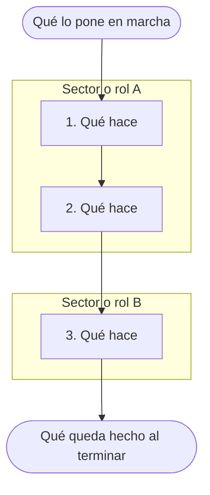

> **Nota para el agente.** Este molde se copia a `empresa/procesos/<area>/<codigo>-<slug>.md` al empezar el relevamiento de un proceso. Si la ficha ya existe, no se copia de nuevo: se le suma lo que cuenta cada persona. En la copia, cada comodín (lo que va entre `<` y `>`) se reemplaza junto con las comillas invertidas que lo rodean, y cada ayuda en cursiva se reemplaza por el contenido. Una parte que todavía no tiene nada conserva su ayuda hasta que haya algo para anotar. Las ayudas que encabezan "Cómo se hace hoy", "Problemas e ideas" y "Cambios propuestos (sin aprobar)" explican la parte y quedan en la copia. Lo que no se sabe se escribe `PENDIENTE: preguntar a <quién>`. Esta nota se borra de la copia. Las reglas de control están en `metodo/control-documental.md`.

# `<nombre del proceso, como figura en el mapa de procesos>`

| Código | Versión | Estado | Vigente desde | Próxima revisión |
|---|---|---|---|---|
| `<código>` | 0 | en curso | — | — |

| Elaboró | Revisó | Aprobó |
|---|---|---|
| `<nombre>` | — | — |

## Cómo se hace hoy

_Esta parte cuenta lo que pasa hoy, no lo que debería pasar._

### Objetivo

_Para qué se hace este trabajo, en una o dos frases. Qué pasaría si nadie lo hiciera._

### Alcance

_Dónde empieza y dónde termina. Qué casos incluye y cuáles quedan afuera._

### Dueño

_Quién responde por que esto salga bien, con nombre de pila y rol. Quién lo cubre cuando no está._

### Participantes

_Quiénes más intervienen, con nombre de pila y rol, y en qué parte._

### Qué lo pone en marcha

_Qué tiene que pasar para que este trabajo empiece._

### Qué hace falta para empezar

_Lo que hay que tener antes de empezar: datos, documentos, autorizaciones. Quién lo entrega._

### Pasos

_Una fila por paso, en el orden en que se hacen. Un paso termina cuando cambia quién lo hace, cuando se decide algo o cuando queda algo hecho. Si un paso lo hacen dos sectores, va en dos filas. En "Con qué" va el sistema, la planilla o el papel que se usa hoy._

| Paso | Quién | Qué hace | Con qué (sistema/planilla) | Cuánto tarda |
|---|---|---|---|---|
| 1 | | | | |
| 2 | | | | |
| 3 | | | | |

### Diagrama

_El diagrama sale de la tabla de pasos y se genera de nuevo cada vez que la tabla cambia, como indica "Diagramas" en `metodo/control-documental.md`. El que sigue es solo un esqueleto: se reemplaza entero._

### Qué queda hecho al terminar

_Qué queda hecho cuando el trabajo termina y a quién le llega. Si lo sigue otro proceso del mapa, nombrarlo como figura ahí._

### Reglas que se siguen

_Los criterios que se aplican para decidir. Una regla por renglón._

### Excepciones

_Los casos que se salen de lo habitual, qué se hace en cada uno y quién lo autoriza._

### Qué registro queda

_Dónde queda anotado que esto se hizo, quién lo guarda y por cuánto tiempo._

### Frecuencia y volumen

_Cada cuánto se hace y cuántos casos son. En qué época hay más._

### Cómo nos damos cuenta de que anda bien

_Cómo se nota hoy que esto sale bien o mal. Si hoy no se mide, decirlo._

### Qué puede salir mal

_Lo que puede fallar, qué consecuencia tiene y qué se hace hoy para evitarlo o para resolverlo._

## Documentos

_Los archivos que se usan en este trabajo y que aportaron las personas. Una línea por archivo, con el enlace y una frase que diga qué es. El detalle de cada archivo está en el `catalogo.md` de su carpeta, en `empresa/adjuntos/`. Si todavía no hay ninguno, esta parte queda vacía._

_Forma de cada línea:_ `- [<archivo>](../../adjuntos/<area>/<proceso>/<archivo>): <qué es>.`

## Problemas e ideas

_Esta parte va separada a propósito. Nada de lo que hay aquí describe cómo se hace hoy. Es material de trabajo: se pone al día sin aprobación y sin cambiar la versión, también con la ficha `vigente`, como indica "Cambios en un documento vigente" en `metodo/control-documental.md`._

### Problemas

_Dónde se traba, qué se repite, qué genera errores o esperas. Hechos, no juicios sobre personas._

### Ideas de mejora

_Lo que propone quien hace el trabajo. Anotar quién lo propuso y la fecha._

## Cambios propuestos (sin aprobar)

_Se usa solo cuando el documento está `vigente`: lo que cambió no se escribe arriba, se anota aquí hasta que se apruebe. En "Qué cambió" van la parte afectada y el texto que va a quedar, tal como quedaría en el cuerpo. Mientras no haya cambios, la tabla queda sin filas._

| Fecha | Quién lo cuenta | Qué cambió | Confirmó el dueño |
|---|---|---|---|

## Historial

| Versión | Fecha | Qué cambió | Quién lo contó | Quién aprobó |
|---|---|---|---|---|
